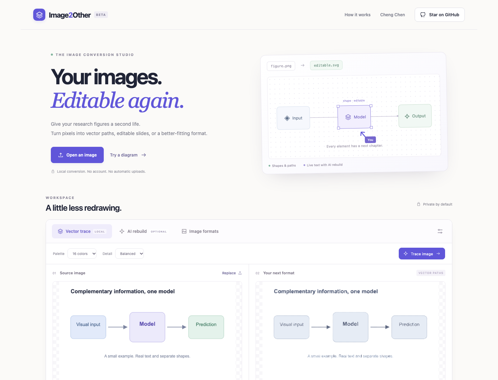

# Image2Other

**Your images. Editable again.**

A local-first conversion studio for research figures, PDFs, slides and everyday images. Trace a raster image into vector paths, reconstruct a diagram with your vision model, export native PowerPoint objects, and manage documents without uploading your files.

The primary workflow is **image → editable SVG artwork + text → edit → export**. OCR assists the text layer; it is not the final product or a substitute for recovering meaningful figure structure.

[Open the studio](https://ceasonen.github.io/Image2Other/) · [中文说明](docs/README.zh-CN.md) · [Research & credits](docs/research.md) · [Report an issue](https://github.com/ceasonen/Image2Other/issues)



## What works today

| Mode | What you get | What stays editable | Requirements |
| --- | --- | --- | --- |
| Text + vectors (default) | OCR boxes plus traced artwork | Reviewed words as SVG text / PPTX text boxes; artwork as paths | Browser OCR after permission, existing local Paddle service, or Paddle JSON |
| Vector trace | Colored vector paths | Path geometry, fill, opacity; PPTX freeform objects | Browser only |
| AI rebuild | A validated scene of text, shapes, lines, and paths | Text content, geometry, colors, arrows | Your compatible vision provider, or Scene JSON from your AI chat |
| Image formats | PNG, JPEG, WebP with resize and quality options | Raster pixels, not semantic objects | Browser only |
| PDF tools | Merge, split, select/reorder/duplicate and rotate pages | Existing PDF page contents; not a page editor | Browser only |
| PDF page export | PNG/JPEG/WebP ZIP, TXT, or send one page to the figure studio | TXT preserves text content; images preserve pixels | Browser only |
| PDF → PPTX | Page-image slides, or native editable text boxes over raster artwork | Text mode: selectable PDF text; shapes/artwork remain raster | Browser only |
| Image batches | Multi-page PDF or one image per PowerPoint slide | Images remain raster | Browser only |
| PPTX extraction | Slide text as TXT; embedded raster images as ZIP | Source text/image content, not rendered slide layouts | Browser only |

**A traced letter is an outline, not a text box.** The default **Text + vectors** mode recognizes words first, lets you review/correct them, removes selected glyph regions, then traces the remaining artwork and inserts native editable text. Outline-only Vector trace remains available. Neither mode recovers the original fonts, layers or semantic connections. Compare labels, equations, layout, and geometry against the source before publication.

Figure-studio PPTX export uses native text boxes, shapes, and custom vector geometry. Document-workspace PPTX modes are different: page-image mode is intentionally raster; text mode removes original PDF glyphs from the background and adds native text boxes. Font/color/placement are approximate, not a recovery of the original slide source. The authored example demonstrates editing/export, not reconstruction accuracy.

## Quick start

Node.js 24+ (the PDF renderer uses modern browser and runtime APIs):

```sh
npm install --ignore-scripts
npm run dev
```

Open `http://127.0.0.1:5178/Image2Other/`.

1. Drop, browse, or paste an image. Try the included raster diagram if you want a quick example.
2. In Text + vectors, allow the small OCR download and click Recognize text. Correct words against their source crops. Use Review mask to inspect removal, optionally Suggest protection, then paint/confirm protected artwork before Build with reviewed text. Or choose Vector trace, AI rebuild, or Image formats.
3. Inspect the complete SVG preview and its new difference map. The browser renders the SVG at a bounded working size and compares it with the same source image. Open Layers to move paths/shapes/text, change colors and fonts, or add text.
4. Select one or several layers and click **Refine selected layers**. A bounded three-step search tests small position changes and accepts a move only when RGB error drops. Undo remains available. Click **Compare again** after a manual edit to start a fresh run.
5. Download SVG, PPTX, Scene JSON, or a raster image. **Export experiment ZIP** locally packages the comparison raster, rendered raster, difference map, initial/final scenes and trial log.

Text + vectors needs no API key and does not upload images. AI rebuild is an optional alternative for semantic shapes/connectors. [AI setup and scene schema](docs/ai-rebuild.md)

### SVG editing and typography

Traced paths have X/Y controls: moving them rewrites actual M/L/Q/C/Z coordinates, including curve controls and hole contours. Bounds use quadratic/cubic extrema rather than just control-point boxes. Shift-click or Select multiple to move selected artwork and labels together. This is explicit selection, not inferred ownership or persistent semantic grouping.

Native line layers have **Start/End target + port** controls. Choose artwork and a bounding-box port manually; moving that artwork updates its attached endpoint, leaving the other target unchanged. Detach before moving a bound line directly. Scene JSON retains stable IDs and constraints; SVG includes endpoint metadata and synchronized geometry. PPTX exports synchronized native lines, **not active Office connection bindings**. A traced arrow is still a path, not automatically a native line; automatic relation recovery and external-editor constraint execution are not implemented.

Figure text defaults to **Times New Roman** in both SVG and native PPTX. The text-layer editor also offers Arial, Calibri and Georgia; Scene JSON retains the choice. Fonts are not embedded, so another device may substitute an unavailable font. This is a requested output style, not recovery of the source font. PDF text-layer conversion remains a separate document workflow.

### Visual feedback and research records

The figure workspace now automatically renders generated SVGs back to pixels and reports RGB mean absolute error plus a difference map against the current source. Comparisons use white compositing and a maximum 1,024-pixel edge / 1,048,576 pixels. A selected group can run three rounds of four axis-aligned shifts (4, 2 and 1 scene pixels), keeping the best lower-error candidate at each round. Text content, colors and connections are not inferred by this search; explicit attachment coordinates follow moved artwork. Existing unrelated scene layers are left unchanged. A lower pixel error is **not** evidence that a label, connector direction or downstream edit is correct.

The user-initiated ZIP export stays local and is capped at 12 MB. Its `feedback.json` includes attempted and accepted moves, working/source sizes and an explicit `annotationStatus: unverified`; text, connection, edit behavior and source-license checks are left null. The included `reference.png` is a scaled working raster, not necessarily the full-resolution input. Pairing these files may help build a development corpus after independently checking rights and structural labels. No files or corrections are collected automatically, and the archive is **not** a verified training dataset or an independent test set. See the [evaluation plan](docs/development-contract.md).

**Local PaddleOCR** is an optional Python bridge, not a hosted model. Configure an existing local inference environment/model pair, paste its session token, explicitly allow the loopback request, and select Local PaddleOCR. Alternatively import PaddleOCR 3.x JSON from the same unmodified source. Imported/local labels use the same review → protected masking → traced artwork + native text → SVG/PPTX pipeline and start unselected. Rotated/preprocessed coordinates are refused. [Setup, supported models and current verification limits](docs/paddleocr.md). No Paddle packages or weights are installed automatically. Re-read label currently uses browser Tesseract, including on imported labels.

### OCR behavior and limits

Tesseract.js 7 / Tesseract LSTM runs in a browser worker, using English or English + Simplified Chinese. Recognition uses up to a 2× working image, capped at a 2,400-pixel edge / 4 megapixels, independently of the 768-pixel artwork trace. Choose diagram, document or single-block segmentation. Confidence 85 is a review heuristic, **not** an 85% correctness guarantee. High-confidence labels on consistent flat backgrounds are preselected; uncertain labels need explicit checking. Mixed-background boxes and detected axis-aligned strokes crossing a box are kept, with a refusal reason in the review. This conservative check is not semantic connector recovery: diagonal strokes and artwork contained inside a box can still be erased. Unselected text remains traced artwork. Inspect the preview and leave an unsafe label unselected. Fonts, size and placement are approximate. Handwriting, equations, rotated labels and very small text are not guaranteed. Transparent artwork backgrounds are retained.

**Review mask** opens a source/erase-map and a preview of remaining artwork before native text is added. Protect artwork, clear protection, undo or reset the draft; only Confirm mask & replace saves it. Closing discards draft changes. Suggest protection uses a small connected-component rule: foreground touching the crop's exterior or a long thin component is kept. It is optional, not a learned separator. Joined text/lines can be kept together, leaving old glyphs; short contained shapes can be missed. Inspect and adjust rather than treating the proposal as accurate. A confirmed mask can override the crossing-stroke refusal, but never the mixed-background refusal. Mask crops are capped at 262,144 pixels, 64 strokes and 2,048 points; no new model download is needed.

Single Latin letter/digit labels, including parenthesized/bracketed identifiers, are not preselected even at high confidence: `B/8` and `I/1` confusions can change scientific meaning. Check the crop and explicitly select/correct them. This deliberately reduces automatic coverage, does not guess corrections and does not catch all formula/identifier errors.

**Re-read label** is an optional assistant for an already detected label: it pads/upscales a bounded crop and runs sparse/single-line/raw-line OCR in one local worker. Compare candidates with the source; scores across layouts are not calibrated probabilities, and agreeing candidates can still be wrong. A choice updates only the text draft and leaves Replace unselected. It does not change boxes, graphics or saved protection masks, and cannot find text the initial pass missed. Close/stop discards an unfinished read. Crop candidates and choices are exported as unverified review evidence, not training truth. No new OCR model is downloaded.

Export review JSON v2 saves unverified OCR observations, local text edits, boxes, refusal reasons, replace decisions and confirmed mask instructions. A rename is not automatically an OCR correction, and mask confirmation is not verified segmentation ground truth. No XGBoost classifier is trained or bundled. Real-browser tests recognize authored raster words, inspect/draw/cancel/confirm a mask, edit a label and verify actual SVG text/path and native PPTX text/vector downloads; this is not a general OCR accuracy benchmark.

```sh
npm test
npm run diagnose:ocr
npm run build
npm run preview
```

The deployment workflow also runs real-browser smoke tests before publishing. To run them locally, start an isolated Chrome instance with a DevTools port:

```sh
node tests/browser.mjs http://127.0.0.1:4178/Image2Other/ 9226
node tests/feedback-browser.mjs http://127.0.0.1:4178/Image2Other/ 9226
node tests/ocr-browser.mjs http://127.0.0.1:4178/Image2Other/ 9226
```

Tests cover native PPTX XML, PDF page operations, forms/input rejection, ordered slide text extraction, safe scene parsing, and the consent boundary. Browser tests inspect actual downloaded files, verify text-mode backgrounds remove original glyphs, exercise PDF/image/slide operations, and check responsive widths. Native-shape and traced-path exports were also rendered with LibreOffice during earlier release QA. Live provider accuracy is not benchmarked.

## Privacy and limits

- Local image, PDF and PPTX tools run on your device. There is no upload backend, account, analytics, or persisted file history. PDF libraries and workers are self-hosted with the application, not fetched from a runtime CDN.
- OCR API/worker scripts and pinned language data are self-hosted (English ~3 MB, Simplified Chinese ~1.7 MB). After permission, jsDelivr supplies the pinned Tesseract.js-core 7 runtime (a few MB). Asset requests contain no image/recognized words. Resources may use the browser's HTTP cache; images and corrections are not persisted. No large research-model weights or datasets load automatically.
- AI rebuild sends the image and prompt **only after consent** to the endpoint you enter. That provider's fees, privacy policy, retention, and CORS rules apply. Do not send confidential review material without permission.
- Provider credentials live in the settings fields for the current page session. We do not put them in localStorage, IndexedDB, URLs, logs, or this repository. Close the page or click Clear credentials to remove them.
- Input limit: 20 MB and 24 megapixels. Local trace uses a maximum 768-pixel working edge and at most 2,000 paths. This trades fine detail for browser responsiveness. It is suited to flat graphics rather than photographic reconstruction.
- PNG/JPEG/WebP export support depends on the browser. JPEG has no transparency; select its background color. Animated inputs export one decoded frame. Resizing does not recover missing detail.
- Imported SVGs must be self-contained and have no scripts, foreign objects, external references, or style blocks. They are decoded as images; their original vector structure is not currently imported as a scene.
- The document queue allows 25 files / 50 MB total, up to 200 PDF pages. Rendering is capped at 40 pages, 12 megapixels per page and 32 megapixels per batch. PPTX extraction caps expanded archive contents at 100 MB / 1,000 files. Choose smaller batches when needed.
- Page changes refuse PDFs containing form/signature fields. Keep originals; document restructuring is not signature preservation. Scans can send a single page to Text + vectors via PDF page → figure studio; there is no bulk scanned-PDF OCR or searchable-PDF export. Password-protected PDFs/PPTX, Office-to-PDF, lossless compression, Word/Excel, EPS and legacy `.ppt` are not implemented. This release does not claim universal conversion or feature parity with Smallpdf.
- PPTX extraction reads common DrawingML text runs and embedded PNG/JPEG/WebP/GIF media. It does not render slides, recover linked images, extract editable charts or guarantee reading order within a slide. Image-to-PDF downscales longest edges above 4,096 pixels and uses white backgrounds.
- Current figure paths support absolute M/L/Q/C/Z commands and solid fills. Gradients, editable equations, automatic connector recovery and active Office connector bindings remain outside the public figure editor.

## Deployment

The independent repository publishes at `https://ceasonen.github.io/Image2Other/`, underneath Cheng Chen's homepage. The personal homepage only links to this tool; its layouts, styles, dependencies, and build stay separate. The project URL uses the repository's case-sensitive name. In repository Settings → Pages, select **GitHub Actions** as the build source. The included workflow runs unit tests, a production build, and actual browser conversions on pull requests, and deploys only from `main` after those checks pass.

Vite's base path is `/Image2Other/`. Change it in `vite.config.js` if you fork the project under another name. Do not copy the application source into your personal homepage repository. Build output lives in `dist/`; dependencies and local test outputs are ignored.

## Development direction

The [shared engineering/research contract](docs/development-contract.md) defines acceptance criteria and the next controlled experiments. The small masking diagnostic deliberately exposes both improvements and remaining failures; it does not claim end-to-end accuracy. Reliable text reconstruction comes before adding more conversion buttons.

Next work includes evaluating stronger OCR engines (e.g. PaddleOCR), learning/calibrating replacement decisions on annotated figures, Office rendering through an opt-in local service and complex-artwork preservation. These are not implemented. XGBoost is a possible lightweight confidence/region gate once annotations exist, not an OCR recognizer. Contributions should include licensed examples, expected elements and actual output.

This is an early usable release, not a claim of better accuracy than existing systems. Our [research map](docs/research.md) separates published methods, engineering references, and actual integrations. VectorHarness directly overlaps relation-preserving reconstruction and local repair; those capabilities alone are not a new contribution. Lightweight selective edit-response recovery remains a candidate requiring evidence. Source-only reference checkouts and a pre-experimental draft stay in an ignored local research directory; no weights or large datasets were downloaded.

## License

Image2Other's original code is MIT licensed. ImageTracerJS is Unlicense/public domain; PptxGenJS and JSZip retain their own licenses. See [THIRD_PARTY_NOTICES.md](THIRD_PARTY_NOTICES.md). Research references are acknowledgements, not claims that their models or code are running inside this application.
